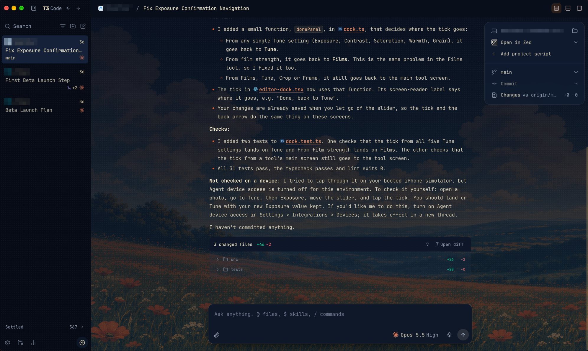

# Twilight Poppies

A dark navy theme for T3 Code, based on an illustration of a poppy field under halftone clouds. It uses cream text, poppy-orange accents, and honey-gold highlights, with a faint dot texture in the chat and sidebar. The poppy field shows through at the bottom of the chat.



It also includes a cream light variant.

## What's in it

- `theme/twilight-poppies.json` holds the colors and the custom CSS.
- `theme/twilight-poppies.png` is the background image for the chat area.

The CSS sets JetBrains Mono Nerd Font for the whole UI. It also tunes the chat text: line height, heading colors, inline code, lists, quotes, and tables.

## Install

Install the font first:

```sh
brew install --cask font-jetbrains-mono-nerd-font
```

Copy both files into your T3 Code themes folder:

```sh
cp theme/twilight-poppies.json theme/twilight-poppies.png ~/.t3/userdata/themes/
```

Then select Twilight Poppies as your theme in T3 Code and switch to dark mode.

The theme CSS can't reach the terminal, so set the terminal font to `JetBrainsMono Nerd Font` in settings as well.

## Removing it

Switch back to a built-in theme such as T3 Chat, then delete the two files from `~/.t3/userdata/themes/`.
